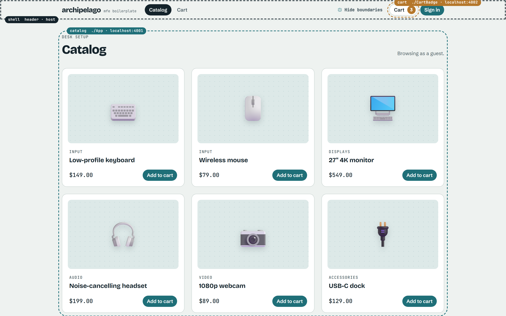
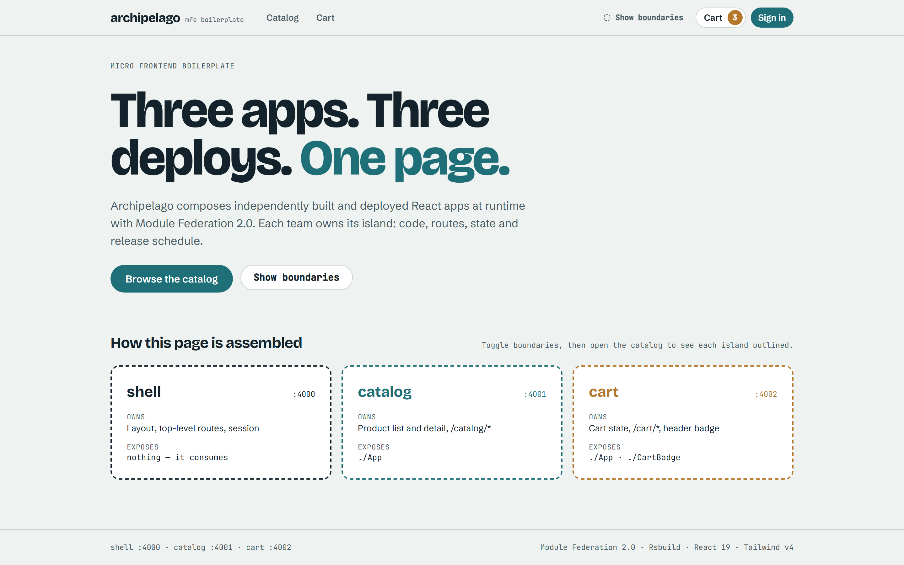
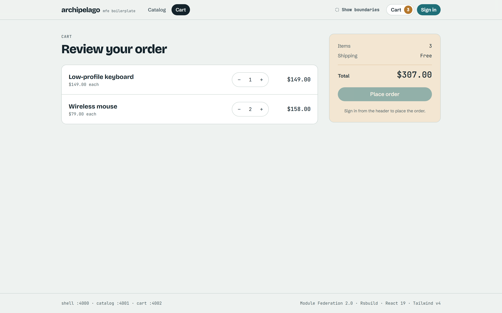
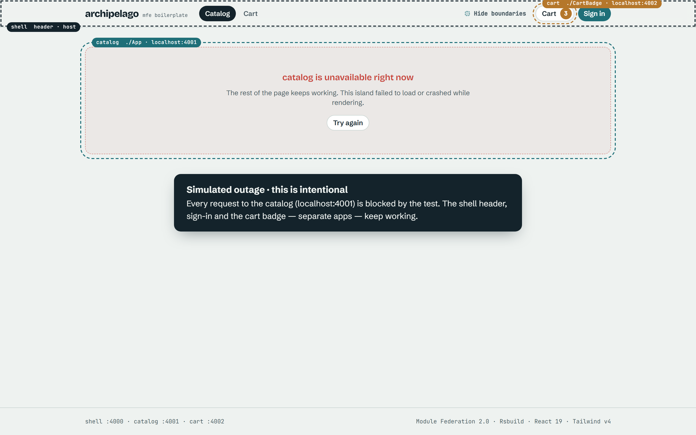
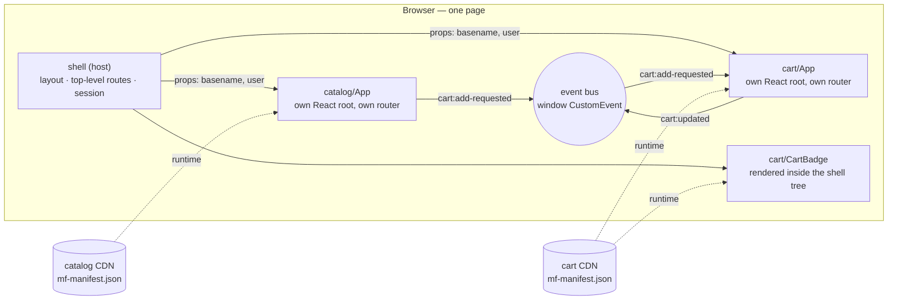

<div align="center">

# archipelago

**A production-minded micro frontend boilerplate. Independent islands, one product.**

Module Federation 2.0 · Rsbuild · React 19 · TypeScript · Tailwind CSS v4 · pnpm + Turborepo · Vitest · Playwright

[](https://github.com/juliocarneiro/archipelago-mfe/actions/workflows/ci.yml)
[](./LICENSE)
[](./CONTRIBUTING.md)

**English** · [Português (Brasil)](./README.pt-BR.md)

</div>

---

Archipelago is a starter for teams that want a **micro frontend platform**: several React apps
that are built, tested and deployed **independently**, then composed into one page **at runtime**.

It ships three example apps (**shell**, **catalog**, **cart**) that already solve the parts most
tutorials skip: one React on the page, communication without coupling, two routers sharing one
URL, a remote going down without taking the page with it, typed contracts, and CI that tests the
real production builds.

Clone it, rename it, delete the demo domains and keep the architecture.



> Press **Show boundaries** in the header to see which app owns each part of the page.

| Home                                 | Cart                                 | Simulated outage: catalog blocked on purpose                                                     |
| ------------------------------------ | ------------------------------------ | ------------------------------------------------------------------------------------------------ |
|  |  |  |

The third image is a **failure test, not a bug**: the catalog server is blocked on purpose to show
that only its area fails while the shell and the cart keep working. Try it yourself in
[docs/07-resiliencia.md](./docs/07-resiliencia.md).

## Contents

- [Why use it](#why-use-it)
- [Requirements](#requirements)
- [Start a new project from this template](#start-a-new-project-from-this-template)
- [Run it](#run-it)
- [Scripts](#scripts)
- [Project structure](#project-structure)
- [How it works](#how-it-works)
- [Rules of the platform](#rules-of-the-platform)
- [Making it yours](#making-it-yours)
- [Configuration](#configuration)
- [Deploying](#deploying)
- [Troubleshooting](#troubleshooting)
- [Learn more](#learn-more)
- [Contributing](#contributing) · [License](#license)

## Why use it

| Problem                             | What Archipelago does                                                                                       |
| ----------------------------------- | ----------------------------------------------------------------------------------------------------------- |
| Composing apps at runtime           | Module Federation 2.0 with `mf-manifest.json`, through the official Rsbuild plugin                          |
| Pages vs widgets                    | **App-level** remotes (own React root via the MF Bridge) and **component-level** remotes (`React.lazy`)     |
| Two copies of React                 | `singleton` shared dependencies from one config package, with real semver ranges. An E2E test checks it     |
| One remote is down                  | `shareStrategy: 'loaded-first'` and an error boundary per app. The rest of the page keeps working. Tested   |
| Apps talking to each other          | Typed event bus on DOM `CustomEvent` with replay: props go down, events go up, one owner per piece of state |
| Two routers, one URL                | The shell owns prefixes (`/catalog/*`), each app owns its sub-routes, and a small sync keeps them aligned   |
| Breaking changes between deploys    | Contract-first types in one package: breaking a contract fails the typecheck of every consumer              |
| CSS leaking between apps            | Tailwind v4 with one shared theme. Only the shell ships the global reset                                    |
| Testing a remote against production | A runtime plugin that points any remote at another URL from `localStorage`, behind a host allowlist         |
| Working on one app alone            | Every remote runs standalone, with a small harness that fakes the shell                                     |
| Keeping boundaries over time        | ESLint blocks app-to-app imports, CODEOWNERS per app, PR template with a contract checklist                 |

## Requirements

- **Node.js 22+** (`.nvmrc` included: `nvm use`)
- **pnpm 11** — run `corepack enable` once and the right version is picked from `package.json`
- Git

Ports **4000**, **4001** and **4002** must be free. To use others, see [Configuration](#configuration).

## Start a new project from this template

Pick one of the three options.

**A. GitHub template (recommended).** Click **Use this template → Create a new repository** at the
top of this page, then clone your new repository:

```bash
git clone https://github.com/<you>/<your-project>.git
cd <your-project>
```

**B. degit (copy without git history):**

```bash
npx degit juliocarneiro/archipelago-mfe my-platform
cd my-platform
git init
```

**C. Plain clone (to study or contribute):**

```bash
git clone https://github.com/juliocarneiro/archipelago-mfe.git
cd archipelago-mfe
```

Then give the project your own package scope and name:

```bash
corepack enable
pnpm install
pnpm init:project --scope @acme --name acme-web   # add --dry-run to preview
pnpm install                                       # refresh the lockfile with the new names
pnpm verify                                        # lint, typecheck, unit tests, build
```

`init:project` renames the `@mfe/` scope in every file, renames the root package and resets
package versions to `0.1.0`. It does not rename the apps (`shell`, `catalog`, `cart`), ports or
UI text — those you change by hand when you replace the demo (see [Making it yours](#making-it-yours)).

## Run it

```bash
pnpm dev
```

| App     | URL                   | What it is                                                         |
| ------- | --------------------- | ------------------------------------------------------------------ |
| shell   | http://localhost:4000 | The host. **Open this one** to see the composed product            |
| catalog | http://localhost:4001 | Remote, running standalone with a fake signed-in user              |
| cart    | http://localhost:4002 | Remote, running standalone with a button that fakes catalog events |

Work on one app alone:

```bash
pnpm --filter @mfe/catalog dev
```

## Scripts

| Command             | What it does                                                                                  |
| ------------------- | --------------------------------------------------------------------------------------------- |
| `pnpm dev`          | Starts all apps with hot reload                                                               |
| `pnpm build`        | Production build of every app into `apps/*/dist`                                              |
| `pnpm preview`      | Builds, then serves the production builds on the same ports                                   |
| `pnpm test`         | Unit and component tests (Vitest) in every package                                            |
| `pnpm typecheck`    | TypeScript in every package                                                                   |
| `pnpm lint`         | ESLint, including the "no app-to-app imports" rule                                            |
| `pnpm format`       | Prettier                                                                                      |
| `pnpm verify`       | lint + typecheck + test + build — run before every PR                                         |
| `pnpm e2e`          | Playwright against the production builds. First time: `pnpm exec playwright install chromium` |
| `pnpm screenshots`  | Regenerates the README images in `docs/assets`                                                |
| `pnpm init:project` | Renames scope and root package for a new project                                              |

## Project structure

```
apps/
  shell/         host: layout, top-level routes, session, error boundaries, runtime plugin
  catalog/       remote: exposes ./App (product list and detail)
  cart/          remote: exposes ./App (cart page) and ./CartBadge (header widget); owns cart state
packages/
  contracts/     domain types, event map, remote props, event bus, history sync
  ui/            design system: Tailwind theme + React components (shared at runtime)
  mf-config/     shared Module Federation settings: ports, shared deps, remote URLs, CORS, fonts
  tsconfig/      base TypeScript configs
e2e/             Playwright tests that cross app boundaries
scripts/         init-project.mjs
docs/            study guide (PT-BR) and architecture decision records
```

Inside each app:

```
src/index.ts         only `import('./bootstrap')` — the async boundary Module Federation needs
src/bootstrap.tsx    standalone entry (not exposed): fakes what the shell would provide
src/export-app.tsx   what the shell loads: createBridgeComponent({ rootComponent: App })
src/App.tsx          the app, receiving the contract props (basename, user)
src/styles.css       federated CSS: Tailwind theme + utilities, no global reset
rsbuild.config.ts    name, exposes, shared, port
```

## How it works



1. The browser opens the shell. Module Federation sets up the shared scope (React, the design
   system, the contracts package) — provided once, by the shell.
2. The header renders `cart/CartBadge`, a component loaded from the cart app at runtime.
3. Visiting `/catalog` loads `catalog/App`. The MF Bridge calls its `render()` with the
   `basename` and `user` props; the catalog creates its own React root and router.
4. **Add to cart** publishes `cart:add-requested`. The catalog does not know the cart exists.
   The cart, which owns the state, updates and publishes `cart:updated`; the badge re-renders.
5. If a remote fails to load, only its area shows an error with **Try again**.

## Rules of the platform

These are the conventions that keep the apps independent. Tooling enforces the first one.

1. **An app never imports another app's code.** Integrate through Module Federation or a package
   in `packages/`. ESLint fails otherwise.
2. **Contracts are public APIs.** Never remove or rename an exposed module, a prop or an event
   field. Add a new version next to the old one, migrate consumers, then remove the old one.
3. **One owner per piece of state.** Other apps publish intents (`cart:add-requested`); only the
   owner publishes facts (`cart:updated`).
4. **Remotes ship no global CSS.** No Tailwind preflight, no element selectors in federated CSS.
5. **Namespace browser storage.** Keys look like `mfe:<app>:<key>:v<n>`; all apps share one origin.
6. **Keep `packages/` small.** Business logic in a shared package couples every team.

## Making it yours

- **Replace the demo domains.** Keep `shell`, rename or replace `catalog` and `cart`. The step-by-step
  for adding an app is in [docs/11-novo-mfe.md](./docs/11-novo-mfe.md) (in Portuguese; the steps are
  code paths you can follow in any language).
- **Real authentication.** Swap the fake session in `apps/shell/src/auth/session.tsx` for your
  identity provider. Keep tokens in `httpOnly` cookies, never in `window` or `localStorage`.
- **Design system.** Tokens live in `packages/ui/src/styles/theme.css` (Tailwind `@theme`).
  Changing one updates every app on its next build.
- **Team ownership.** Put your teams in `.github/CODEOWNERS`.
- **Fonts.** `fontTags` in `packages/mf-config/index.js`.

## Configuration

Everything shared between apps lives in [`packages/mf-config/index.js`](./packages/mf-config/index.js):

| Setting             | Where                | Notes                                                                  |
| ------------------- | -------------------- | ---------------------------------------------------------------------- |
| Dev ports           | `ports`              | Also used for CORS origins and remote URLs                             |
| Shared dependencies | `createShared()`     | Add libraries with global state or Context here, as `singleton`        |
| MF defaults         | `federationDefaults` | `shareStrategy: 'loaded-first'`, `dts: false`, explicit bridge routing |
| Allowed origins     | `allowedOrigins`     | Dev-server CORS. In production, configure CORS on each remote's CDN    |

Environment variables read at **build time of the shell**:

| Variable             | Default                 | Purpose                     |
| -------------------- | ----------------------- | --------------------------- |
| `PUBLIC_CATALOG_URL` | `http://localhost:4001` | Where the catalog is served |
| `PUBLIC_CART_URL`    | `http://localhost:4002` | Where the cart is served    |

**Pointing a remote somewhere else at runtime** (for example, a preview deploy of a pull request),
from the browser console on the shell:

```js
localStorage.setItem(
  'mfe:overrides',
  JSON.stringify({ catalog: 'http://localhost:5001/mf-manifest.json' }),
);
location.reload();
// undo: localStorage.removeItem('mfe:overrides')
```

Only hosts listed in `ALLOWED_OVERRIDE_HOSTS` (`apps/shell/src/mf/platform-runtime-plugin.ts`) are
accepted. Add your preview domains there, and nothing else.

## Deploying

Each app is a static site. Deploy them **separately**, each to its own bucket/CDN/project:

```bash
pnpm --filter @mfe/catalog build    # → apps/catalog/dist
pnpm --filter @mfe/cart build       # → apps/cart/dist

PUBLIC_CATALOG_URL=https://catalog.example.com \
PUBLIC_CART_URL=https://cart.example.com \
pnpm --filter @mfe/shell build      # → apps/shell/dist
```

Checklist:

- **Cache:** `mf-manifest.json` and the shell's `index.html` with `Cache-Control: no-cache`;
  hashed files in `static/` with `max-age=31536000, immutable`.
- **CORS:** each remote's host must allow the shell's origin.
- **SPA fallback:** the shell host must serve `index.html` for unknown paths (deep links).
- **Rollback:** republish the previous `mf-manifest.json`. Assets are immutable, so it is instant.

Details in [docs/09-deploy-e-versionamento.md](./docs/09-deploy-e-versionamento.md).

## Troubleshooting

| Symptom                                                | Likely cause and fix                                                                           |
| ------------------------------------------------------ | ---------------------------------------------------------------------------------------------- |
| `localhost:4000` shows another app                     | Something else uses the port. Change `ports` in `mf-config`                                    |
| Blank page when one remote is down                     | `shareStrategy` changed back to `version-first`. Keep `loaded-first`                           |
| "Invalid hook call"                                    | Two Reacts. Check `__FEDERATION__.__SHARE__` in the console; keep React `singleton` everywhere |
| "Shared module is not available for eager consumption" | An app's `index.ts` lost the `import('./bootstrap')` async boundary                            |
| Remote chunks 404 on the shell's domain                | Remote built without `assetPrefix: 'auto'`                                                     |
| CORS error loading `mf-manifest.json`                  | Shell origin missing from the remote's allowed origins (dev) or CDN headers (prod)             |
| Styles missing for a design-system component           | The app's CSS lost its `@source '../../../packages/ui/src'` line                               |

More, with the real story behind each one: [docs/10-armadilhas.md](./docs/10-armadilhas.md).

## Learn more

A study guide in Portuguese walks through every decision: [docs/README.md](./docs/README.md).

Architecture decision records:

| #                                                | Decision                                                 |
| ------------------------------------------------ | -------------------------------------------------------- |
| [0001](./docs/adr/0001-module-federation-2.md)   | Module Federation 2.0 on Rsbuild for runtime composition |
| [0002](./docs/adr/0002-monorepo.md)              | One monorepo, independent deploys                        |
| [0003](./docs/adr/0003-event-bus.md)             | Communicate through a typed DOM event bus                |
| [0004](./docs/adr/0004-contract-first-types.md)  | Contract-first types instead of generated remote types   |
| [0005](./docs/adr/0005-loaded-first-sharing.md)  | `loaded-first` share strategy for failure isolation      |
| [0006](./docs/adr/0006-tailwind-shared-theme.md) | Tailwind v4 with a shared theme and shell-only preflight |

## Contributing

Issues and pull requests are welcome. Read [CONTRIBUTING.md](./CONTRIBUTING.md) and run
`pnpm verify` and `pnpm e2e` before opening a PR.

## License

[MIT](./LICENSE) © [Julio Carneiro](https://github.com/juliocarneiro)
