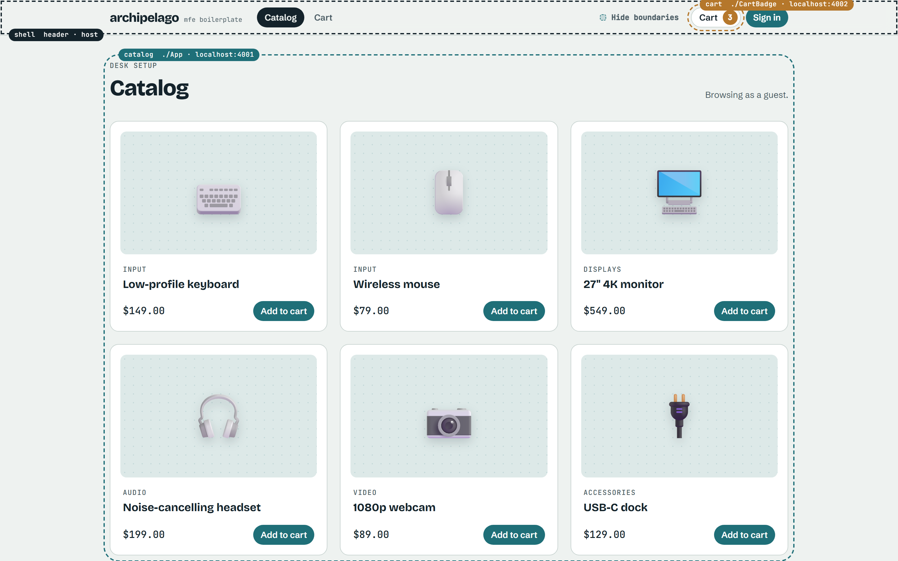
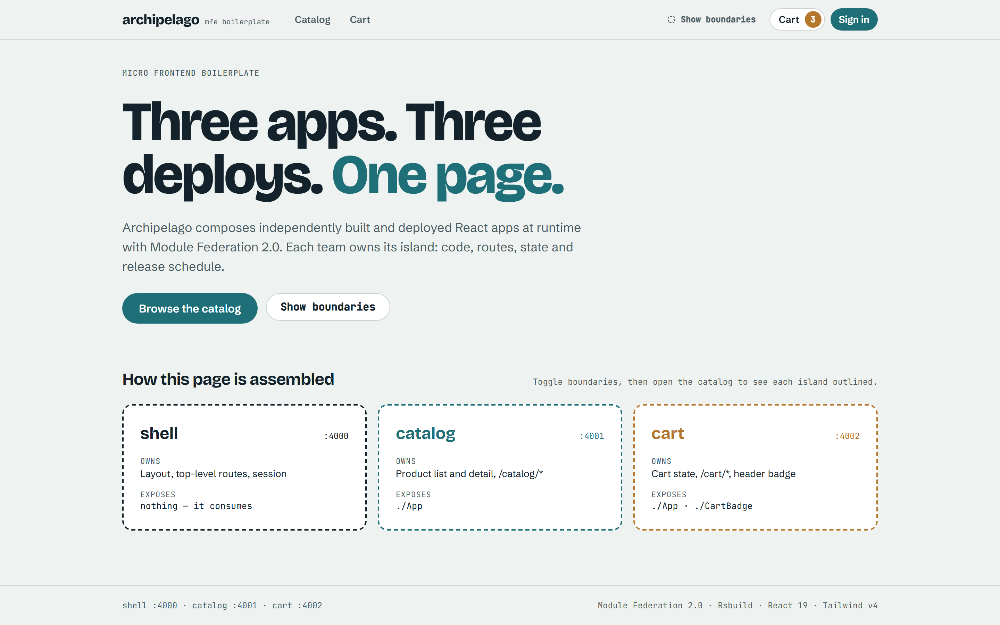
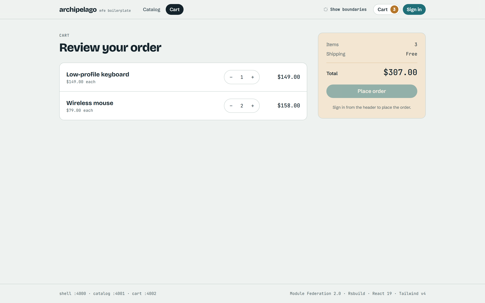
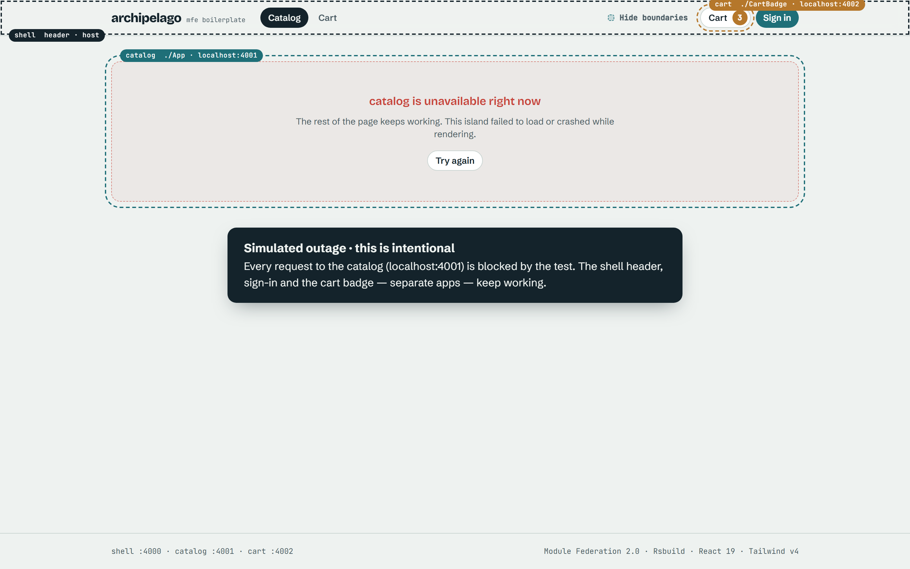
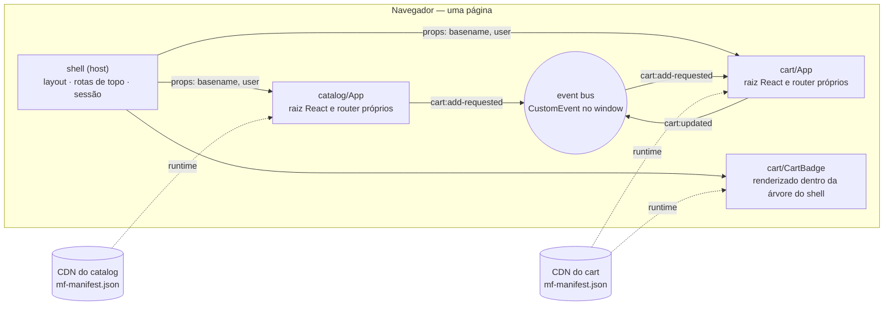

<div align="center">

# archipelago

**Um boilerplate de micro frontends pensado para produção. Ilhas independentes, um produto só.**

Module Federation 2.0 · Rsbuild · React 19 · TypeScript · Tailwind CSS v4 · pnpm + Turborepo · Vitest · Playwright

[](https://github.com/juliocarneiro/archipelago-mfe/actions/workflows/ci.yml)
[](./LICENSE)
[](./CONTRIBUTING.md)

[English](./README.md) · **Português (Brasil)**

</div>

---

O Archipelago é um ponto de partida para times que querem uma **plataforma de micro frontends**:
várias aplicações React buildadas, testadas e deployadas de forma **independente**, compostas numa
única página **em runtime**.

Ele vem com três apps de exemplo (**shell**, **catalog**, **cart**) que já resolvem o que a maioria
dos tutoriais pula: um só React na página, comunicação sem acoplamento, dois routers dividindo a
mesma URL, um remote caindo sem derrubar a página, contratos tipados e um CI que testa os builds
reais de produção.

Clone, renomeie, apague os domínios de exemplo e fique com a arquitetura.



> Clique em **Show boundaries** no header para ver qual app é dono de cada parte da página.

| Home                            | Carrinho                            | Falha simulada: catálogo bloqueado de propósito                                              |
| ------------------------------- | ----------------------------------- | -------------------------------------------------------------------------------------------- |
|  |  |  |

A terceira imagem é um **teste de falha, não um bug**: o servidor do catálogo é bloqueado de
propósito para mostrar que só a área dele falha, enquanto o shell e o carrinho continuam
funcionando. Faça o teste você mesmo em [docs/07-resiliencia.md](./docs/07-resiliencia.md).

## Sumário

- [Por que usar](#por-que-usar)
- [Requisitos](#requisitos)
- [Começar um projeto novo a partir deste template](#começar-um-projeto-novo-a-partir-deste-template)
- [Rodando](#rodando)
- [Scripts](#scripts)
- [Estrutura do projeto](#estrutura-do-projeto)
- [Como funciona](#como-funciona)
- [Regras da plataforma](#regras-da-plataforma)
- [Deixando o projeto com a sua cara](#deixando-o-projeto-com-a-sua-cara)
- [Configuração](#configuração)
- [Deploy](#deploy)
- [Problemas comuns](#problemas-comuns)
- [Para estudar](#para-estudar)
- [Contribuindo](#contribuindo) · [Licença](#licença)

## Por que usar

| Problema                          | O que o Archipelago faz                                                                                               |
| --------------------------------- | --------------------------------------------------------------------------------------------------------------------- |
| Compor apps em runtime            | Module Federation 2.0 com `mf-manifest.json`, pelo plugin oficial do Rsbuild                                          |
| Páginas vs widgets                | Remotes **app-level** (raiz React própria via MF Bridge) e **component-level** (`React.lazy`)                         |
| Duas cópias do React              | Dependências `singleton` vindas de um único pacote de config, com faixas semver reais. Um teste E2E verifica          |
| Um remote fora do ar              | `shareStrategy: 'loaded-first'` e um error boundary por app. O resto da página continua funcionando. Testado          |
| Apps conversando entre si         | Event bus tipado sobre `CustomEvent` com replay: props descem, eventos sobem, um dono por estado                      |
| Dois routers, uma URL             | O shell é dono dos prefixos (`/catalog/*`), cada app das suas sub-rotas, e uma sincronização mantém os dois alinhados |
| Quebras de contrato entre deploys | Tipos contract-first num pacote só: quebrar um contrato falha o typecheck de todos os consumidores                    |
| CSS vazando entre apps            | Tailwind v4 com um tema compartilhado. Só o shell aplica o reset global                                               |
| Testar um remote contra produção  | Runtime plugin que aponta qualquer remote para outra URL via `localStorage`, com allowlist de hosts                   |
| Trabalhar num app sozinho         | Todo remote roda standalone, com um harness que simula o shell                                                        |
| Manter as fronteiras com o tempo  | ESLint bloqueia imports entre apps, CODEOWNERS por app, template de PR com checklist de contrato                      |

## Requisitos

- **Node.js 22+** (`.nvmrc` incluso: `nvm use`)
- **pnpm 11** — rode `corepack enable` uma vez e a versão certa é escolhida pelo `package.json`
- Git

As portas **4000**, **4001** e **4002** precisam estar livres. Para usar outras, veja [Configuração](#configuração).

## Começar um projeto novo a partir deste template

Escolha uma das três opções.

**A. Template do GitHub (recomendado).** Clique em **Use this template → Create a new repository**
no topo desta página e clone o seu repositório novo:

```bash
git clone https://github.com/<voce>/<seu-projeto>.git
cd <seu-projeto>
```

**B. degit (copia sem o histórico do git):**

```bash
npx degit juliocarneiro/archipelago-mfe minha-plataforma
cd minha-plataforma
git init
```

**C. Clone comum (para estudar ou contribuir):**

```bash
git clone https://github.com/juliocarneiro/archipelago-mfe.git
cd archipelago-mfe
```

Depois, dê ao projeto o seu scope e o seu nome:

```bash
corepack enable
pnpm install
pnpm init:project --scope @acme --name acme-web   # use --dry-run para só ver o que muda
pnpm install                                       # atualiza o lockfile com os nomes novos
pnpm verify                                        # lint, typecheck, testes unitários, build
```

O `init:project` troca o scope `@mfe/` em todos os arquivos, renomeia o pacote raiz e volta as
versões dos pacotes para `0.1.0`. Ele não renomeia os apps (`shell`, `catalog`, `cart`), as portas
nem os textos da interface — isso você muda à mão quando substituir o exemplo (veja
[Deixando o projeto com a sua cara](#deixando-o-projeto-com-a-sua-cara)).

## Rodando

```bash
pnpm dev
```

| App     | URL                   | O que é                                                                |
| ------- | --------------------- | ---------------------------------------------------------------------- |
| shell   | http://localhost:4000 | O host. **Abra este** para ver o produto composto                      |
| catalog | http://localhost:4001 | Remote rodando sozinho, com um usuário logado de mentira               |
| cart    | http://localhost:4002 | Remote rodando sozinho, com um botão que simula os eventos do catálogo |

Trabalhar num app só:

```bash
pnpm --filter @mfe/catalog dev
```

## Scripts

| Comando             | O que faz                                                                                         |
| ------------------- | ------------------------------------------------------------------------------------------------- |
| `pnpm dev`          | Sobe todos os apps com hot reload                                                                 |
| `pnpm build`        | Build de produção de todos os apps em `apps/*/dist`                                               |
| `pnpm preview`      | Builda e serve os builds de produção nas mesmas portas                                            |
| `pnpm test`         | Testes unitários e de componente (Vitest) em todos os pacotes                                     |
| `pnpm typecheck`    | TypeScript em todos os pacotes                                                                    |
| `pnpm lint`         | ESLint, incluindo a regra "app não importa app"                                                   |
| `pnpm format`       | Prettier                                                                                          |
| `pnpm verify`       | lint + typecheck + test + build — rode antes de todo PR                                           |
| `pnpm e2e`          | Playwright contra os builds de produção. Na primeira vez: `pnpm exec playwright install chromium` |
| `pnpm screenshots`  | Regera as imagens do README em `docs/assets`                                                      |
| `pnpm init:project` | Renomeia scope e pacote raiz para um projeto novo                                                 |

## Estrutura do projeto

```
apps/
  shell/         host: layout, rotas de topo, sessão, error boundaries, runtime plugin
  catalog/       remote: expõe ./App (lista e detalhe de produtos)
  cart/          remote: expõe ./App (página do carrinho) e ./CartBadge (widget do header); dono do estado do carrinho
packages/
  contracts/     tipos de domínio, mapa de eventos, props dos remotes, event bus, sync de histórico
  ui/            design system: tema Tailwind + componentes React (compartilhado em runtime)
  mf-config/     config de Module Federation compartilhada: portas, shared, URLs, CORS, fontes
  tsconfig/      configs base de TypeScript
e2e/             testes Playwright que atravessam fronteiras entre apps
scripts/         init-project.mjs
docs/            guia de estudo e registros de decisão de arquitetura (ADRs)
```

Dentro de cada app:

```
src/index.ts         só `import('./bootstrap')` — o async boundary que o Module Federation exige
src/bootstrap.tsx    entrada standalone (não exposta): simula o que o shell forneceria
src/export-app.tsx   o que o shell carrega: createBridgeComponent({ rootComponent: App })
src/App.tsx          o app, recebendo as props do contrato (basename, user)
src/styles.css       CSS federado: tema + utilities do Tailwind, sem reset global
rsbuild.config.ts    name, exposes, shared, porta
```

## Como funciona



1. O navegador abre o shell. O Module Federation monta o escopo compartilhado (React, design
   system, pacote de contratos) — fornecido uma única vez, pelo shell.
2. O header renderiza `cart/CartBadge`, um componente carregado do app do carrinho em runtime.
3. Ao visitar `/catalog`, o shell carrega `catalog/App`. O MF Bridge chama o `render()` dele com as
   props `basename` e `user`; o catálogo cria sua própria raiz React e seu router.
4. **Add to cart** publica `cart:add-requested`. O catálogo não sabe que o carrinho existe. O
   carrinho, dono do estado, atualiza e publica `cart:updated`; o badge re-renderiza.
5. Se um remote não carregar, só a área dele mostra um erro com **Try again**.

## Regras da plataforma

Estas convenções mantêm os apps independentes. A primeira é garantida por ferramenta.

1. **Um app nunca importa código de outro app.** Integre via Module Federation ou por um pacote em
   `packages/`. O ESLint falha caso contrário.
2. **Contratos são APIs públicas.** Nunca remova nem renomeie um módulo exposto, uma prop ou um campo
   de evento. Crie a versão nova ao lado da antiga, migre os consumidores e só então remova a antiga.
3. **Um dono por estado.** Outros apps publicam intenções (`cart:add-requested`); só o dono publica
   fatos (`cart:updated`).
4. **Remotes não trazem CSS global.** Nada de preflight do Tailwind nem seletores de elemento no CSS federado.
5. **Storage com namespace.** Chaves no formato `mfe:<app>:<chave>:v<n>`; todos os apps dividem a mesma origem.
6. **Mantenha `packages/` pequeno.** Regra de negócio num pacote compartilhado acopla todos os times.

## Deixando o projeto com a sua cara

- **Troque os domínios de exemplo.** Mantenha o `shell`, renomeie ou substitua `catalog` e `cart`. O
  passo a passo para adicionar um app está em [docs/11-novo-mfe.md](./docs/11-novo-mfe.md).
- **Autenticação de verdade.** Troque a sessão fake em `apps/shell/src/auth/session.tsx` pelo seu
  provedor de identidade. Tokens em cookie `httpOnly`, nunca em `window` ou `localStorage`.
- **Design system.** Os tokens ficam em `packages/ui/src/styles/theme.css` (`@theme` do Tailwind).
  Mudar um atualiza todos os apps no próximo build de cada um.
- **Donos por time.** Coloque seus times em `.github/CODEOWNERS`.
- **Fontes.** `fontTags` em `packages/mf-config/index.js`.

## Configuração

Tudo que é compartilhado entre apps fica em [`packages/mf-config/index.js`](./packages/mf-config/index.js):

| Configuração        | Onde                 | Observações                                                                   |
| ------------------- | -------------------- | ----------------------------------------------------------------------------- |
| Portas de dev       | `ports`              | Também usadas nas origens de CORS e nas URLs dos remotes                      |
| Dependências shared | `createShared()`     | Libs com estado global ou Context entram aqui, como `singleton`               |
| Padrões do MF       | `federationDefaults` | `shareStrategy: 'loaded-first'`, `dts: false`, roteamento explícito no bridge |
| Origens permitidas  | `allowedOrigins`     | CORS do dev server. Em produção, configure o CORS no CDN de cada remote       |

Variáveis de ambiente lidas no **build do shell**:

| Variável             | Padrão                  | Para quê                 |
| -------------------- | ----------------------- | ------------------------ |
| `PUBLIC_CATALOG_URL` | `http://localhost:4001` | Onde o catalog é servido |
| `PUBLIC_CART_URL`    | `http://localhost:4002` | Onde o cart é servido    |

**Apontar um remote para outro lugar em runtime** (por exemplo, o preview de um pull request), pelo
console do navegador no shell:

```js
localStorage.setItem(
  'mfe:overrides',
  JSON.stringify({ catalog: 'http://localhost:5001/mf-manifest.json' }),
);
location.reload();
// desfazer: localStorage.removeItem('mfe:overrides')
```

Só hosts listados em `ALLOWED_OVERRIDE_HOSTS` (`apps/shell/src/mf/platform-runtime-plugin.ts`) são
aceitos. Adicione ali seus domínios de preview, e nada além deles.

## Deploy

Cada app é um site estático. Faça o deploy **separado**, cada um no seu bucket/CDN/projeto:

```bash
pnpm --filter @mfe/catalog build    # → apps/catalog/dist
pnpm --filter @mfe/cart build       # → apps/cart/dist

PUBLIC_CATALOG_URL=https://catalog.exemplo.com \
PUBLIC_CART_URL=https://cart.exemplo.com \
pnpm --filter @mfe/shell build      # → apps/shell/dist
```

Checklist:

- **Cache:** `mf-manifest.json` e o `index.html` do shell com `Cache-Control: no-cache`; arquivos
  com hash em `static/` com `max-age=31536000, immutable`.
- **CORS:** o host de cada remote precisa liberar a origem do shell.
- **Fallback de SPA:** o host do shell precisa servir o `index.html` para caminhos desconhecidos (deep links).
- **Rollback:** republique o `mf-manifest.json` anterior. Os assets são imutáveis, então é instantâneo.

Detalhes em [docs/09-deploy-e-versionamento.md](./docs/09-deploy-e-versionamento.md).

## Problemas comuns

| Sintoma                                                | Causa provável e correção                                                                    |
| ------------------------------------------------------ | -------------------------------------------------------------------------------------------- |
| `localhost:4000` mostra outro app                      | Outro processo usa a porta. Mude `ports` no `mf-config`                                      |
| Página em branco quando um remote cai                  | `shareStrategy` voltou para `version-first`. Mantenha `loaded-first`                         |
| "Invalid hook call"                                    | Dois Reacts. Veja `__FEDERATION__.__SHARE__` no console; mantenha React `singleton` em todos |
| "Shared module is not available for eager consumption" | O `index.ts` de um app perdeu o async boundary `import('./bootstrap')`                       |
| Chunks do remote dando 404 no domínio do shell         | Remote buildado sem `assetPrefix: 'auto'`                                                    |
| Erro de CORS ao carregar `mf-manifest.json`            | Origem do shell fora das origens permitidas do remote (dev) ou dos headers do CDN (prod)     |
| Estilos faltando num componente do design system       | O CSS do app perdeu a linha `@source '../../../packages/ui/src'`                             |

Mais casos, com a história real de cada um: [docs/10-armadilhas.md](./docs/10-armadilhas.md).

## Para estudar

Um guia de estudo em português explica cada decisão: [docs/README.md](./docs/README.md).

Registros de decisão de arquitetura:

| #                                                | Decisão                                                        |
| ------------------------------------------------ | -------------------------------------------------------------- |
| [0001](./docs/adr/0001-module-federation-2.md)   | Module Federation 2.0 sobre Rsbuild para composição em runtime |
| [0002](./docs/adr/0002-monorepo.md)              | Um monorepo, deploys independentes                             |
| [0003](./docs/adr/0003-event-bus.md)             | Comunicação via event bus tipado no DOM                        |
| [0004](./docs/adr/0004-contract-first-types.md)  | Tipos contract-first em vez de tipos gerados dos remotes       |
| [0005](./docs/adr/0005-loaded-first-sharing.md)  | `loaded-first` para isolamento de falhas                       |
| [0006](./docs/adr/0006-tailwind-shared-theme.md) | Tailwind v4 com tema compartilhado e preflight só no shell     |

## Contribuindo

Issues e pull requests são bem-vindos. Leia o [CONTRIBUTING.md](./CONTRIBUTING.md) e rode
`pnpm verify` e `pnpm e2e` antes de abrir um PR.

## Licença

[MIT](./LICENSE) © [Julio Carneiro](https://github.com/juliocarneiro)
