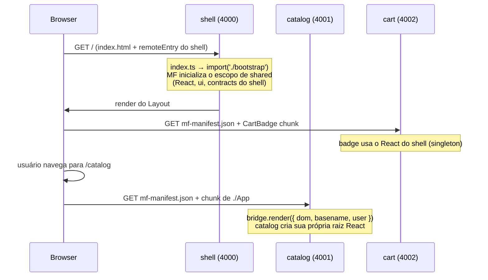

# 02 — Arquitetura do projeto

## As três ilhas

| App       | Tipo   | É dono de                                  | Expõe                  |
| --------- | ------ | ------------------------------------------ | ---------------------- |
| `shell`   | host   | layout, rotas de topo, sessão, resiliência | nada (só consome)      |
| `catalog` | remote | lista e detalhe de produtos, `/catalog/*`  | `./App`                |
| `cart`    | remote | estado do carrinho, `/cart/*`, badge       | `./App`, `./CartBadge` |

A regra mais importante do shell: **ele não tem regra de negócio de nenhum domínio.** Se você
se pegar escrevendo lógica de produto no shell, ela está no lugar errado.

## Os pacotes compartilhados

| Pacote           | Quando é usado  | Para quê                                                        |
| ---------------- | --------------- | --------------------------------------------------------------- |
| `@mfe/contracts` | build + runtime | Tipos de domínio, mapa de eventos, props dos remotes, event bus |
| `@mfe/ui`        | build + runtime | Tema Tailwind e componentes React (singleton no MF)             |
| `@mfe/mf-config` | só build        | Portas, `shared`, URLs dos remotes, CORS, fontes                |
| `@mfe/tsconfig`  | só build        | Configs base de TypeScript                                      |

`contracts` e `ui` são **Just-in-Time packages** (padrão do Turborepo): o `exports` aponta
direto para `src/*.ts`, sem etapa de build. Quem consome compila. Menos configuração, HMR
funcionando entre pacotes.

> **Cuidado com o pacote compartilhado gigante.** Todo código em `packages/` acopla todos os
> MFEs. Se `@mfe/contracts` virar um "utils" com regra de negócio, você recriou o monolito
> com passos extras. Só entra lá o que realmente cruza fronteiras.

## Fluxo de boot (o que acontece quando você abre `localhost:4000`)

Pontos a notar:

1. **Os remotes só são baixados quando usados** (graças a `shareStrategy: 'loaded-first'`,
   veja o [capítulo 07](./07-resiliencia.md)).
2. O `index.ts` de cada app só faz `import('./bootstrap')`. Esse "async boundary" é o que dá
   ao MF tempo de negociar as dependências compartilhadas antes de o React rodar.
3. O catálogo roda com **raiz React própria** (app-level via bridge); o badge roda **dentro
   da árvore do shell** (component-level). Os dois modelos estão aqui de propósito.

## Fronteiras protegidas por ferramenta

Boas intenções não seguram arquitetura; ferramentas sim:

- **ESLint** (`eslint.config.js`): `no-restricted-imports` impede `apps/catalog` de importar
  qualquer coisa de `apps/cart`. A única integração permitida é runtime (MF) ou `packages/`.
- **CODEOWNERS** (`.github/CODEOWNERS`): PR que mexe em `apps/cart` pede review do time do cart;
  PR em `packages/` pede review da plataforma (afeta todo mundo).
- **Testes E2E de arquitetura** (`e2e/platform.spec.ts`): falham se surgir um segundo React
  na página.

Próximo: [03 — Module Federation a fundo](./03-module-federation.md)
